# LiDAR Cube Viewer V02 · Operator Guide

[简体中文](README.md) | **English**

Use V02 for routine APS calibration. Record six stationary ROS 2 bags on the same vehicle with the same sensor installation. Check the six target regions in one window and run calibration to obtain the front, left, right and top LiDAR mounts in `sensor_kit_base_link`. The front mount stays fixed. The left and right groups share one top LiDAR estimate. For per-bag tuning and algorithm development, see the [V01 developer edition](https://github.com/Libpet-Siyuan-Owen/lidar_cube_viewer/tree/V01master).

[Metrics](#reading-the-metrics) · [Single-LiDAR grades](#single-lidar-plane-grades) · [Pair grades](#plane-matching-grades) · [Export criteria](#initial-fit-joint-solve-and-export)

## Install and start

Use Ubuntu 22.04, ROS 2 Humble, system Python 3 and a graphical desktop. WSLg also works. With Humble installed and the ROS package repository configured, run the following commands.

```bash
sudo apt update
sudo apt install git python3-numpy python3-scipy python3-yaml python3-tk python3-matplotlib fonts-noto-cjk ros-humble-rclpy ros-humble-sensor-msgs ros-humble-tf2-msgs ros-humble-ros2bag ros-humble-rosbag2-storage-default-plugins
git clone --branch V02master https://github.com/Libpet-Siyuan-Owen/lidar_cube_viewer.git
cd lidar_cube_viewer
source /opt/ros/humble/setup.bash
/usr/bin/python3 lidar_cube_viewer.py
```

For an existing clone, run `git fetch origin` and `git switch V02master`, then launch the viewer from the repository root. Source the Humble setup in each new terminal. Offline calibration reads the bags directly without running the vehicle nodes.

## Set up the target and six placements

Choose open, level ground. Mount a trihedral target with edges about 40 cm long on a stand. Set up three placements visible to the front, left and top LiDARs (FLT). Repeat for the front, right and top LiDARs (FRT). Measure forward along the ground from **the start of each group's shared field of view**. Determine left and right while facing the straight-ahead placement.

Mark the vehicle orientation on the ground as shown. The vehicle makes an angle of about 30° with the pictured reference direction. Aim the corner where the three target faces meet toward the LiDAR group. Use the photos to align the edges and stand. Measure the height from the ground to the indicated stand attachment point, about 1.5 m.

| Vehicle orientation | Target orientation from the LiDAR side | Target height from the side |
|---|---|---|
| 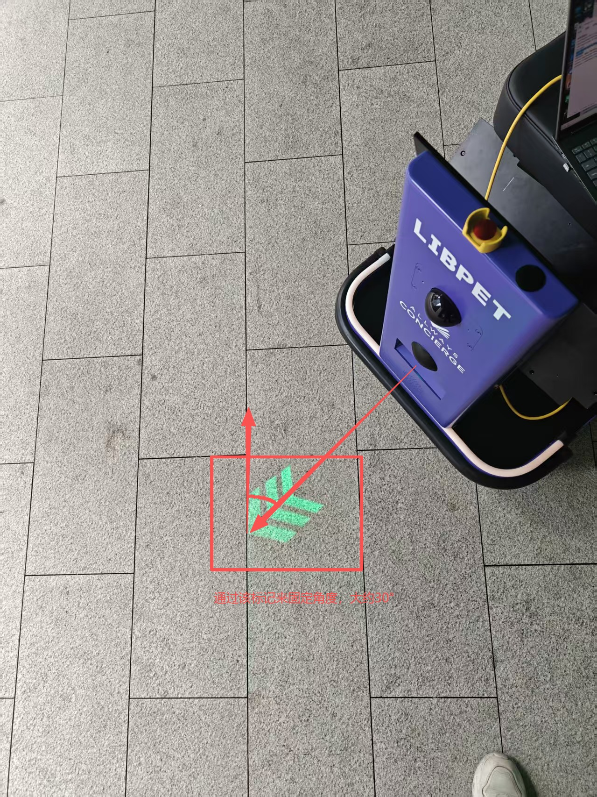 | 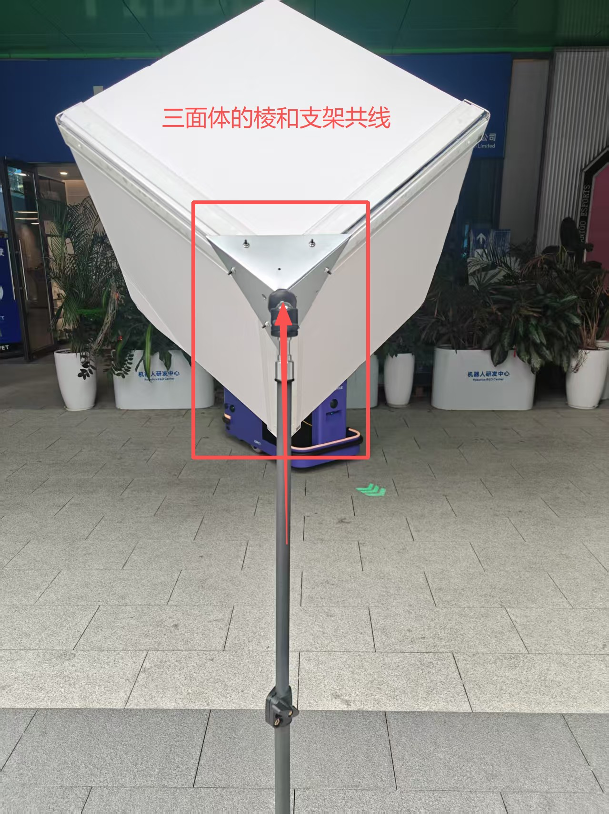 | 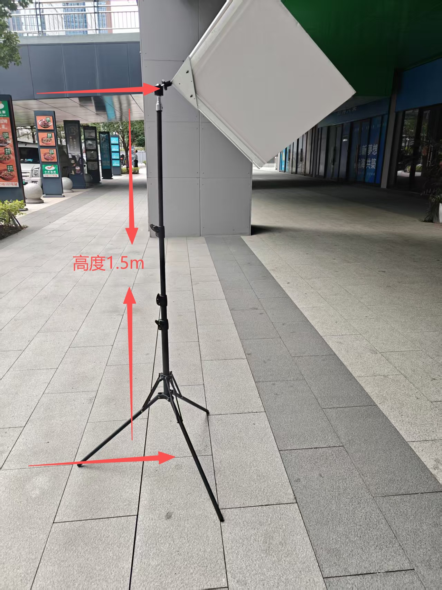 |

| F · Straight ahead | R · Offset right | L · Offset left |
|---|---|---|
| 3.0 m forward, no offset | 2.1 m forward, then 0.3 m right | 2.1 m forward, then 0.3 m left |
| 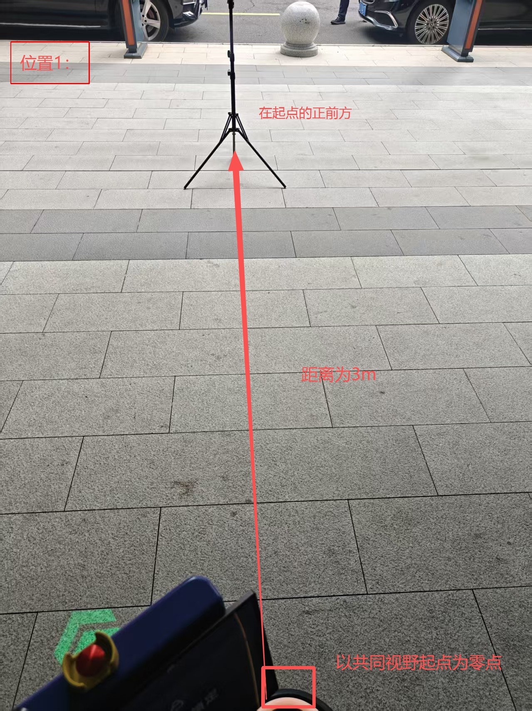 | 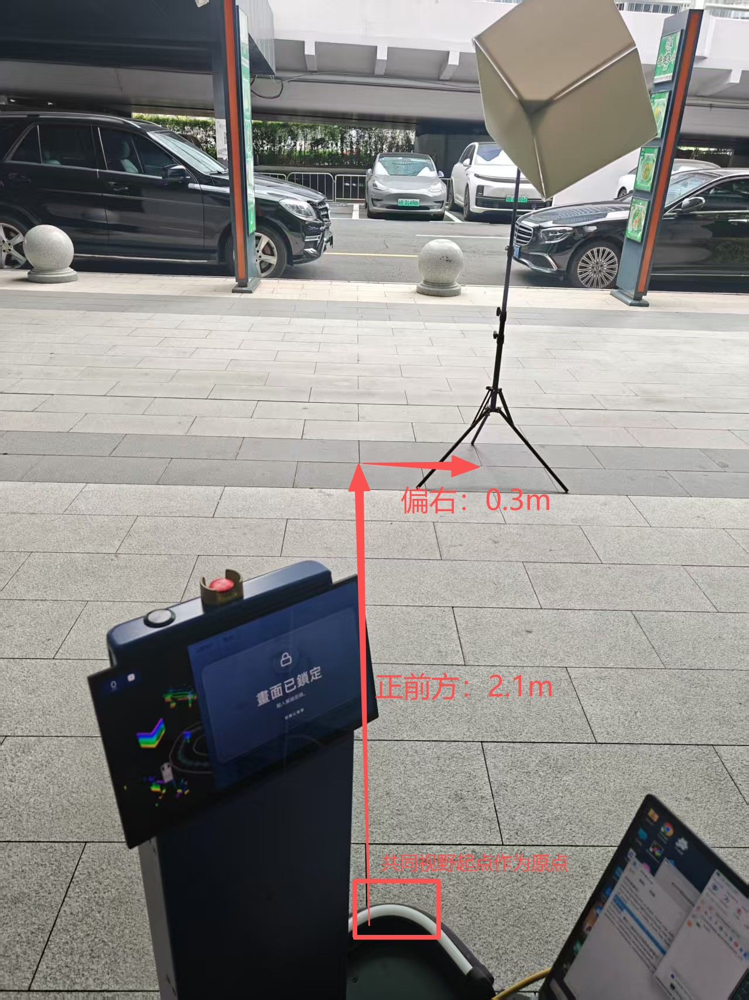 | 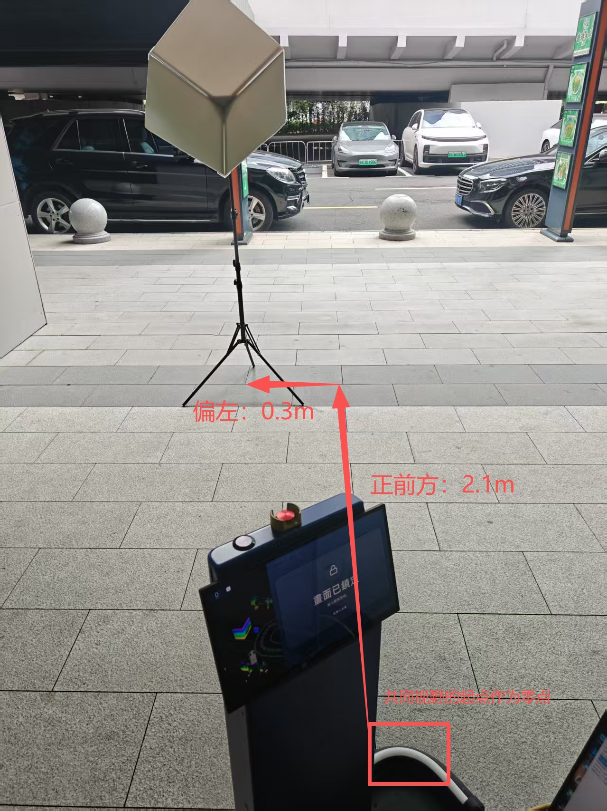 |

Before each recording, check that all three LiDARs in the group can see all three faces. Keep the APS and stand still until recording finishes. Click a photo to see its original markings.

## Name and record the bags

Use one parent directory per APS. Place all six bag directories directly inside it. Keep `metadata.yaml` and all `.db3` segments together in each bag directory. The viewer reads the **bag directory name** to identify the group and placement.

| Item | Recognition rule |
|---|---|
| LiDAR group | Use `front`, `left`, `top` for FLT or `front`, `right`, `top` for FRT. Names can appear in any order or case, with or without separators. The abbreviations FLT and FRT alone are insufficient. |
| Placement | Use uppercase F, L or R outside the LiDAR names. It can appear next to a digit or lowercase text. F3d, 0.3L and 0.3R also work. Underscores keep names easy to read. Letters within a run of uppercase letters do not count as a placement. |
| Ambiguous names | Missing keywords, both side LiDARs or two placement directions prevent automatic assignment. If multiple bags match one cell, click it to select one. A saved machine configuration takes priority. |

For example, `L_topfrontleft_001` and `static_front_top_left_0.3L_2.1d_1.5h` both identify the FLT left-offset placement.

In a terminal that receives the vehicle's ROS 2 topics, replace `aps_001` with your machine ID and define the shell function below. Each call records three point-cloud topics, `/tf` and `/tf_static`.

```bash
source /opt/ros/humble/setup.bash
mkdir -p ~/calibration_ws/data/aps_001
cd ~/calibration_ws/data/aps_001
record_pose() {
  local side="$1" pose="$2"
  timeout --preserve-status --signal=INT 6s ros2 bag record -s sqlite3 -o "front_${side}_top_${pose}" \
    /sensing/lidar/front/pointcloud_raw_ex \
    "/sensing/lidar/${side}/pointcloud_raw_ex" \
    /sensing/lidar/top/pointcloud_raw_ex /tf /tf_static
}
```

**Run one command after positioning the target.** Keep the APS and target still. Recording stops automatically six seconds after the command starts. Wait for the prompt before moving the target.

| Placement | Front, left and top | Front, right and top |
|---|---|---|
| Straight ahead | `record_pose left F` | `record_pose right F` |
| Offset left | `record_pose left L` | `record_pose right L` |
| Offset right | `record_pose left R` | `record_pose right R` |

Run `ros2 bag info front_left_top_F` for the first bag, then check the others. All three `sensor_msgs/msg/PointCloud2` topics and `/tf_static` should have nonzero message counts. Inspect `/tf` as well. The front cloud's `frame_id` should be `rslidar_airy_front`. The static transform chain must connect `sensor_kit_base_link` to every LiDAR. The world-frame preview also needs a transform that locates the front LiDAR in `map`.

## Run calibration and export the result

1. Click **选择数据目录** (Select data directory) and open the machine directory containing the six bags. The top row shows FLT and the bottom row FRT. Each row shows straight ahead, offset left and offset right. Click a cell to replace an incorrectly assigned bag.

   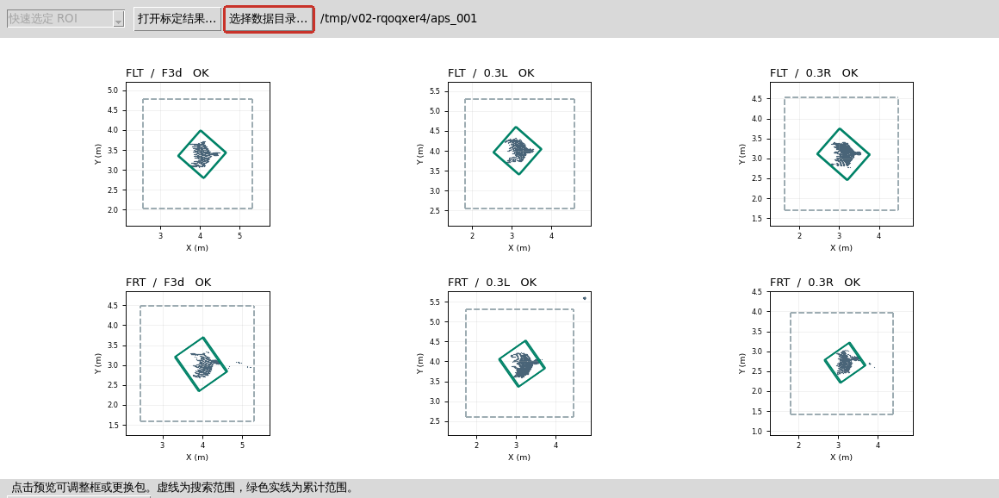

2. Check that the **solid green ROI** encloses all three target faces in each cell. The dashed outline marks the search area. Click a cell to move or resize the green box in the XY and XZ projections, then click **确认此 ROI** (Confirm this ROI). Confirm manually if automatic localization fails. With no map available, the preview can use the first eight frames. Calibration reads the full bag.

   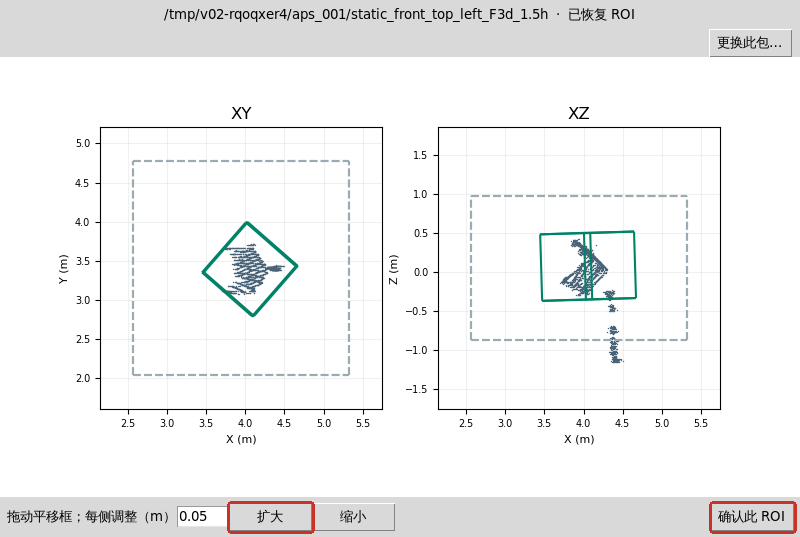

3. If needed, expand **平面拟合和滤波参数（六包共用）** (Plane fitting and filter settings, shared by all six bags). First check that the ROI excludes the ground, stand and walls. The defaults fit three faces with a 0.02 m inlier distance, at least 20 inliers, 100 iterations, an 80° minimum angle and a 0–2 m span range. The filter defaults to a 0.02 m voxel and requires at least five points within a 0.06 m radius, including the point itself.
4. Click **确认全部并开始标定** (Confirm all and start calibration). The viewer uses each bag's `/tf_static` to accumulate and filter points and extract planes. It holds the front mount fixed and fits the other three mounts using point-to-plane residuals from all six placements. It then reopens the original bags with the candidate extrinsics and repeats accumulation, filtering, fitting and grading. **初始** (Initial) and **复验** (Recheck) identify these two measurements.

   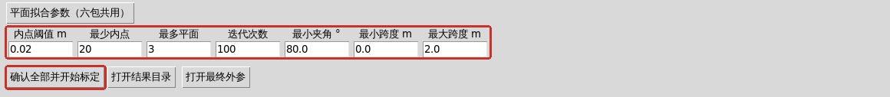

5. On **平面拟合** (Plane fitting) or **面面匹配** (Plane matching), choose the table or bar chart. Select a placement to compare the initial extrinsics (gray) with the joint solution (blue). Hover over a bar for the grade and any per-face failure reason. **安装修正** (Mount corrections) shows changes from `/tf_static`. Use the run selector to revisit earlier runs in the current window.

   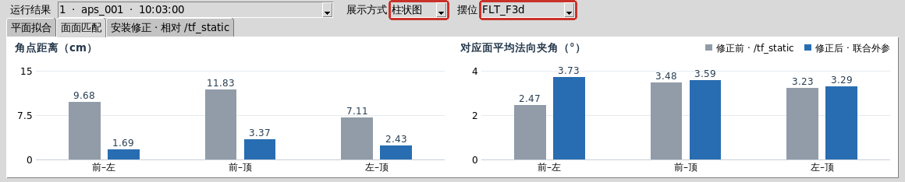

6. After a successful recheck, click **打开最终外参** (Open final extrinsics). Each completed recheck creates a new `FLRT_V02_result_report_<timestamp>/` under the machine directory. Deliver `suggested_extrinsics.yaml`. XYZ are in meters and roll, pitch and yaw are in radians. `validation.json` contains initial and recheck metrics for each face and pair, including failures. `batch_config.yaml` stores ROIs and parameters. If rechecking fails, inspect `candidate.yaml`. If calibration stops earlier, check the status and completed table rows.

   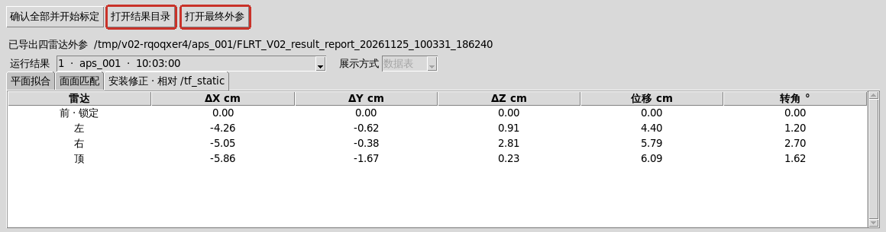

`V02_machine.yaml` in the machine directory saves the bag choices and shared settings. `V02_ROI.yaml` inside each bag saves its confirmed ROI.

## Inspect the 3D clouds and fitted planes

After a successful calibration, or after loading a successful result with **打开标定结果…** (Open calibration result), select **3D点云展示** (3D point clouds) at the top left. Select the placement and extrinsics. Drag to rotate and scroll to zoom. Each LiDAR's points and fitted faces share a color. Each face extends to the projected boundary of its inliers. Clear **显示拟合平面** (Show fitted planes) to inspect the accumulated points alone. Switching extrinsics for the same placement preserves the view. The table shows the report's initial and recheck metrics.

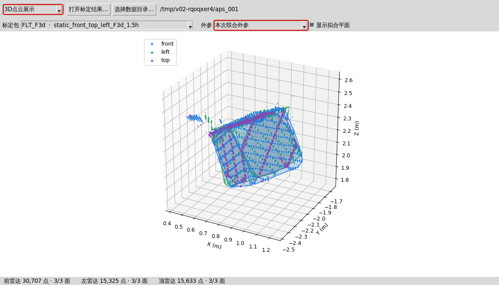

New reports cache clouds and faces for all six placements under both `/tf_static` and the joint solution in `clouds_3d/`. Copy the entire result directory for offline viewing. To use a different YAML for the first time or open an old report without cached data, keep the result directory alongside the six original bags. The viewer reaccumulates and refits from the appropriate bag, then caches the result.

## Reading the metrics

| Metric | Calculation and interpretation |
|---|---|
| Maximum deviation from a right angle (°) | For each of the three pairs of unit face normals, compute `θ = acos(abs(n₁ · n₂))` in degrees. The largest `90° − θ` is displayed. Smaller values indicate a more nearly orthogonal fit. |
| Maximum single-face fit RMS (mm) | For every inlier `x` of a face with unit normal `n` and offset `d`, compute `e = abs(n · x + d)`. The face RMS is `sqrt(mean(e²))`. Display the largest of the three face RMS values, converted from meters to millimeters. |
| Corner distance (cm) | Each LiDAR independently solves `N c = −d` for the intersection of its three planes. For two LiDARs observing the same placement, report `100 × ‖c_A − c_B‖` in a common frame. This measures separation at the target. |
| Mean angle between corresponding normals (°) | For each of the three matched face pairs, compute `acos(abs(n_A · n_B))` in degrees, then take the arithmetic mean. Reversing a normal leaves the angle unchanged. |
| Mount correction | In `sensor_kit_base_link`, subtract the original `/tf_static` position from the joint estimate to obtain ΔX, ΔY and ΔZ. Displacement is their Euclidean norm in cm. The angle is the rotation angle of `R_old⁻¹ R_new` in degrees. Both are zero for the fixed front LiDAR. |

## Single-LiDAR plane grades

Each face is graded individually. P95 is the 95th percentile of its inliers' absolute point-to-plane distances. The inlier fraction uses the number of filtered points supplied for that LiDAR as its denominator. The two face spans are the ranges of inlier projections on the two principal in-plane directions. Grading uses the larger span.

| Face grade | RMS | P95 | Inlier fraction | Larger span |
|---|---:|---:|---:|---:|
| PASS (all criteria met) | ≤ 5 cm | ≤ 10 cm | ≥ 1% | ≤ 1.20 m |
| WARNING (below PASS and meets all criteria here) | ≤ 8 cm | ≤ 20 cm | ≥ 0.5% | ≤ 1.50 m |
| FAIL | Any value outside the WARNING limits | | | |

A LiDAR needs exactly three faces with valid normals. Three PASS faces give PASS. At least one WARNING and no FAIL gives WARNING. A missing face, invalid normal or failed face gives FAIL. The maximum right-angle deviation helps identify possible background surfaces. The adjustable minimum inter-plane angle governs extraction. The summary grade has no additional right-angle threshold.

## Plane matching grades

Both LiDARs must supply three independent directions. Exactly one one-to-one assignment must meet the unsigned normal angle limit of 25° for every matched face. For each match, pool the distances from all of A's face inliers to B's plane and from all of B's face inliers to A's plane. Calculate RMS and P95 directly from this pooled sample, retaining any translation offset.

| Matched face grade | Normal angle | Bidirectional point-to-plane RMS | Bidirectional point-to-plane P95 |
|---|---:|---:|---:|
| PASS (all criteria met) | ≤ 15° | ≤ 5 cm | ≤ 10 cm |
| WARNING (below PASS and meets all criteria here) | ≤ 25° | ≤ 8 cm | ≤ 20 cm |
| FAIL | Any value exceeds a WARNING limit, or no valid measurement is available | | |

A LiDAR pair fails if either individual fit fails, the complete unique assignment is missing, or any matched face fails. Three PASS matches give PASS. Any other complete assignment without a FAIL gives WARNING. The corner distance and mean normal angle summarize overall alignment. Grading uses the **per-face** limits above. Overlap and Chamfer distance are recorded as diagnostics and do not affect acceptance.

## Initial fit, joint solve and export

1. **Initial fit.** Accumulate ROI points with the original `/tf_static`. Each LiDAR's three-face fit must be PASS or WARNING. All three LiDAR pairs at a placement must have complete assignments that agree on the face numbering. An initial pair can still enter the solver if it fails only because its point-to-plane RMS or P95 is too large.
2. **Six-bag joint solve.** Hold the front mount fixed and fit one orthogonal trihedron per placement. All six placements share the same mount corrections. Each physical LiDAR must have the same frame and initial mount across bags. The viewer reports the reason if geometry or solver convergence prevents completion.
3. **Recheck and export.** Replay all six original bags using the same joint extrinsics. Each placement has three LiDAR pairs. Export `suggested_extrinsics.yaml` only when all 18 pairs have three matched faces and a PASS or WARNING grade. If any pair fails, the completed recheck records failures and retains the candidate for inspection. This recheck uses the six placements included in the solve.

For example, the front–left pair at the straight-ahead `aps_001` placement initially had a mean normal angle of 2.90°. Front face 3 and left face 1 had a bidirectional RMS of 10.89 cm, above the 8 cm limit, so the initial match failed. The complete geometric correspondence allowed the solve to proceed. On recheck, the corner distance fell from 10.38 cm to 3.07 cm, the largest bidirectional face RMS was 1.34 cm and the pair passed.
