# LiDAR Cube Viewer V02 · 用户版

**简体中文** | [English](README.en.md)

面向现场标定人员，用于完成 APS 四雷达日常标定。需要逐包调参或排查标定算法时，请使用 [V01 开发版](https://github.com/Libpet-Siyuan-Owen/lidar_cube_viewer/tree/V01master)。

一台 APS 采六个静态包，操作员在一个窗口核对六个靶框，点击一次即可求出前、左、右、顶四台雷达相对 `sensor_kit_base_link` 的安装外参。需要同一台车、同一次安装。软件固定前雷达，左、右两组共用同一个顶部雷达解。

[关键指标怎么算](#表格里的数值怎么计算) · [单雷达评级](#单雷达平面如何评级) · [面面匹配评级](#两台雷达的面面匹配如何评级) · [修正与导出条件](#初始联合求解和最终导出)

## 安装和启动

使用 Ubuntu 22.04、ROS 2 Humble、系统 Python 3 和图形桌面（WSL 可用 WSLg）。已安装 Humble 并配置 ROS 软件源后执行：

```bash
sudo apt update
sudo apt install git python3-numpy python3-scipy python3-yaml python3-tk python3-matplotlib fonts-noto-cjk ros-humble-rclpy ros-humble-sensor-msgs ros-humble-tf2-msgs ros-humble-ros2bag ros-humble-rosbag2-storage-default-plugins
git clone --branch V02master https://github.com/Libpet-Siyuan-Owen/lidar_cube_viewer.git
cd lidar_cube_viewer
source /opt/ros/humble/setup.bash
/usr/bin/python3 lidar_cube_viewer.py
```

已有仓库可执行 `git fetch origin`，运行 `git switch V02master` 后在仓库根目录启动。每个新终端先加载 Humble 环境。离线标定无需启动车辆节点。

## 准备场地和六个摆位

选空旷平地，用支架固定约 40 cm 边长的三面体。先摆前、左、顶共同可见的一组，再摆前、右、顶共同可见的一组。每组都从**本组共同视野的起点**沿地面基线量距，面向正前摆位区分左偏、右偏。按图在地面标出 APS 方向，车体与图示参考方向约 30°。调好靶的朝向和倾角，让三面交点朝向本组雷达，并按图对齐棱线与支架。高度按图中标示的支架连接位置量至地面，约 1.5 m。

| APS 方向和地面标记 | 从雷达一侧检查三面体朝向 | 从侧面量靶高 |
|---|---|---|
| 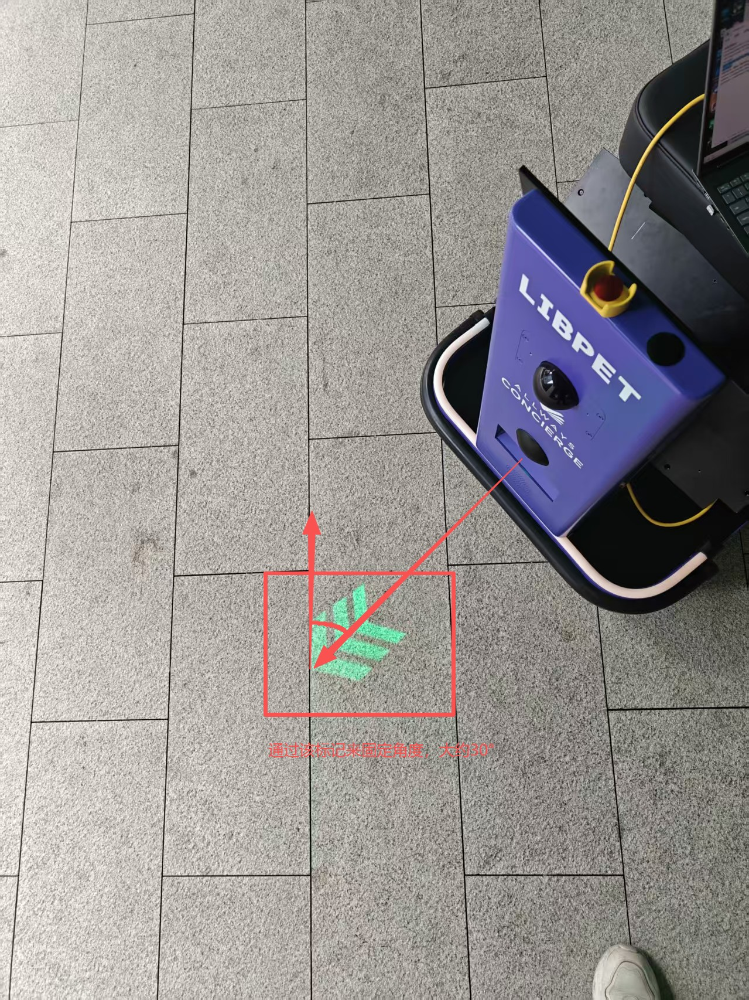 | 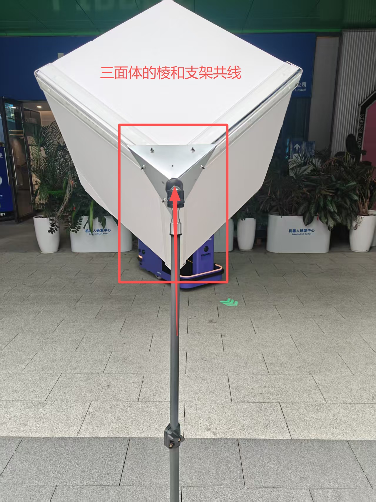 | 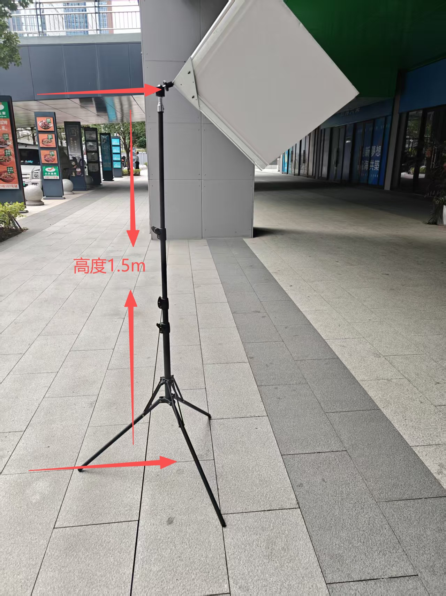 |

| F · 正前 | R · 右偏 | L · 左偏 |
|---|---|---|
| 向前 3.0 m，横移 0 | 向前 2.1 m，再向右 0.3 m | 向前 2.1 m，再向左 0.3 m |
| 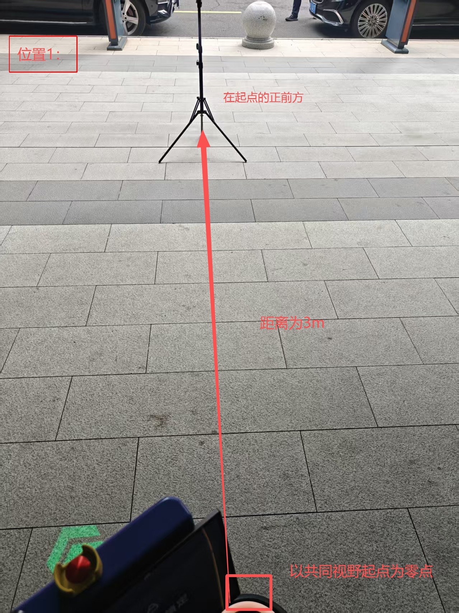 | 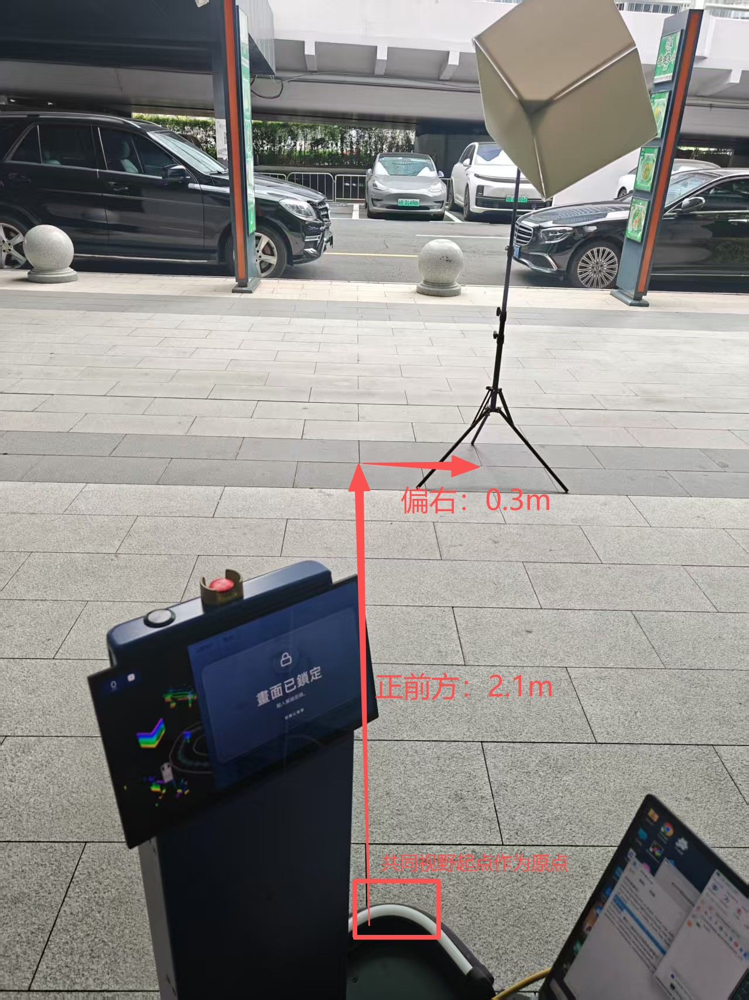 | 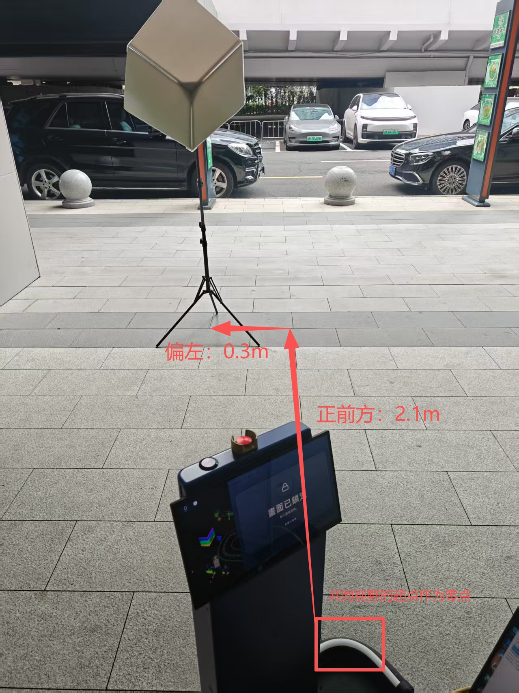 |

每个摆位先确认本组三台雷达都能看到三个面，再开始录制。录制期间 APS 和支架都保持静止；停止录制后再移动到下一摆位。可点击图片查看原始标注。

## 数据命名与采集

一台 APS 对应一个父目录。每个 bag 直接放在该目录下，保留 `metadata.yaml` 和全部 `.db3` 分片。软件从 **bag 子目录名** 提取关键词。

| 内容 | 识别方式 |
|---|---|
| 雷达组合 | `front`、`left`、`top` 为 FLT；`front`、`right`、`top` 为 FRT。英文雷达名可换序、连写，大小写均可。只写 `FLT` 或 `FRT` 不足以识别组合。 |
| 摆位 | 在雷达名以外取大写 `F`、`L` 或 `R`，分别代表正前、左偏、右偏。字母可在目录名任意位置，可以紧邻数字或小写描述，也支持原有 `F3d`、`0.3L`、`0.3R`。推荐用下划线隔开。连续大写缩写里的字母不算摆位。 |
| 缺少或有歧义 | 缺少关键词、同时出现两种侧雷达或两种方向，均不自动归位。同一格有多个候选时点该格人工选包。已有机器配置会优先恢复已保存的选择。 |

例如 `L_topfrontleft_001` 和 `static_front_top_left_0.3L_2.1d_1.5h` 都属于 FLT 左偏。下面六条采集命令本身就是一套可用的目录命名示例。

在能收到车辆 ROS 2 话题的终端运行以下准备命令。将 `aps_001` 改为本台机器编号。函数每次录制三路点云、`/tf` 和 `/tf_static`，共五个话题。

```bash
source /opt/ros/humble/setup.bash
mkdir -p ~/calibration_ws/data/aps_001
cd ~/calibration_ws/data/aps_001
record_pose() {
  local side="$1" pose="$2"
  timeout --preserve-status --signal=INT 6s ros2 bag record -s sqlite3 -o "front_${side}_top_${pose}" \
    /sensing/lidar/front/pointcloud_raw_ex \
    "/sensing/lidar/${side}/pointcloud_raw_ex" \
    /sensing/lidar/top/pointcloud_raw_ex /tf /tf_static
}
```

**每摆好一个位置，单独运行对应的一行。** 运行后保持 APS 和标定物静止。命令从启动起计时 **6 秒**，随后自动停止录制并保存当前包。等终端提示符重新出现，再移动标定物。前左顶和前右顶的六个摆位均按此时长采集。

| 摆位 | 前左顶 | 前右顶 |
|---|---|---|
| 正前 | `record_pose left F` | `record_pose right F` |
| 左偏 | `record_pose left L` | `record_pose right L` |
| 右偏 | `record_pose left R` | `record_pose right R` |

用 `ros2 bag info front_left_top_F` 检查该包，确认三路 `sensor_msgs/msg/PointCloud2` 和 `/tf_static` 的消息数大于零，并检查 `/tf`。前点云的 `frame_id` 应为 `rslidar_airy_front`，静态变换链应能连接 `sensor_kit_base_link` 与各雷达。世界坐标预览需要能定位前雷达的 `map` 变换。

## 操作与导出

1. 点击 **选择数据目录**，选含六个 bag 的机器目录。上排为前左顶，下排为前右顶，每排依次为正前、左偏、右偏。发现错包可点击对应格更换。

   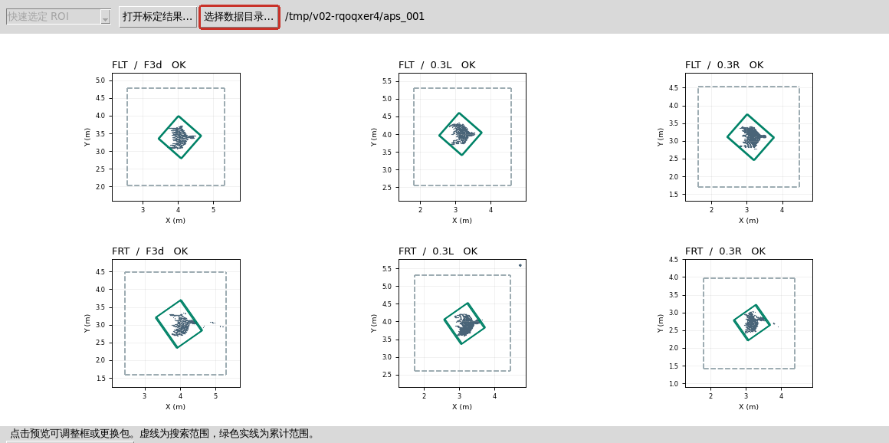

2. 核对六格 **绿色实线 ROI** 是否完整包住靶的三个面。虚线表示自动搜索范围。点击格子可在 XY、XZ 两个投影拖动绿框，或扩大、缩小，再点 **确认此 ROI**。未能自动定位的格子需要人工确认。无地图时预览可使用前八帧；正式累计读取全包。

   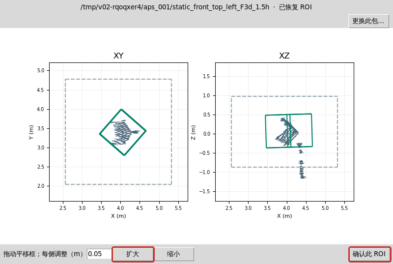

3. 需要调整时展开 **平面拟合参数（六包共用）**。默认内点距离 0.02 m，最少 20 个内点，3 个面，100 次迭代，最小面间夹角 80°，跨度范围 0–2 m。首先检查 ROI，确认排除了地面、支架和墙面，再调整这些参数。
4. 点击 **确认全部并开始标定**。程序先用每包的 `/tf_static` 累计、滤波和提取三个面，再固定前雷达，以六个摆位的点面残差联合求解其余三台雷达。最后用同一套候选外参重新读取六个原始包，累计、滤波、提面并评分。下方的「初始」和「复验」分别对应这两次测量。

   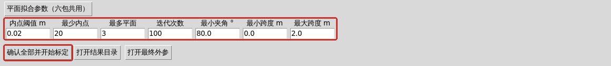

5. 在 **平面拟合** 或 **面面匹配** 页切换数据表／柱状图。柱状图按摆位查看，灰色表示初始外参，蓝色表示联合外参；悬停可看评级和逐面失败原因。**安装修正** 表给出相对 `/tf_static` 的变化。结果轮次下拉框可回看当前窗口内的运行。

   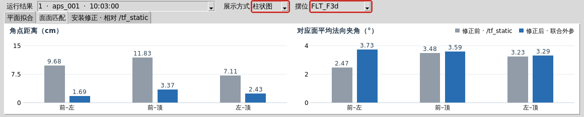

6. 复验通过后点击 **打开最终外参**。机器目录下每次完整复验都会生成新的 `FLRT_V02_result_report_时间戳/`。`suggested_extrinsics.yaml` 是可交付的外参，XYZ 单位为 m，roll/pitch/yaw 为 rad。`validation.json` 包含初始、复验的逐面和逐配对指标以及失败项，`batch_config.yaml` 记录 ROI 和参数。复验未通过时可查看 `candidate.yaml` 辅助排查。提前中止时查看界面状态和已完成的表格行。

   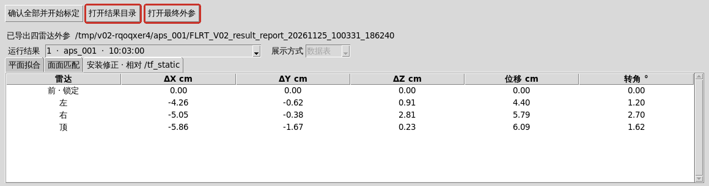


机器目录中的 `V02_machine.yaml` 保存六包选择和共用参数，各包的 `V02_ROI.yaml` 保存已确认的范围。下文列出界面指标和判定条件。

## 查看 ROI 内的 3D 点云与拟合平面

完成六包标定或点击「打开标定结果…」选择一次成功的结果目录后，在左上角切换到「3D点云展示」。选择摆位和外参，用鼠标拖动旋转、滚轮缩放。每台雷达的点和拟合面同色，面片范围由实际内点的投影边界确定。取消「显示拟合平面」可查看原始累计点。切换同一摆位的外参会保留观察角度和范围，下方表格显示本次报告的初始与复验指标。

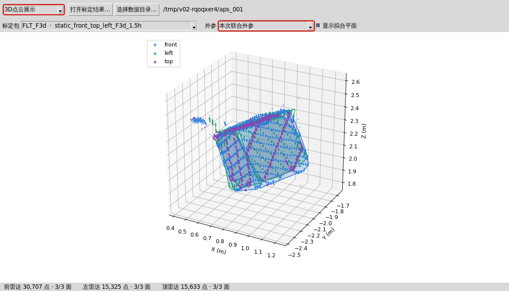

新报告的 `clouds_3d/` 包含六个摆位在 `/tf_static` 和联合外参下的点云与面片，连同整个结果目录复制即可离线查看。首次使用不同的 YAML 或打开无缓存的旧报告时，请把结果目录与六个原始 bag 放在同一父目录下。软件会从对应原包重新累计和拟合，再次查看时直接读取缓存。

## 表格里的数值怎么计算

| 指标 | 算法与含义 |
|---|---|
| 最大直角偏差（°） | 同一雷达三个面构成三个法向夹角。对单位法向取 `θ = acos(abs(n₁ · n₂))` 并换算为度，显示三个 `90° − θ` 中的最大值。越小表示三面越接近正交。 |
| 最大单面拟合 RMS（mm） | 对一个面的全部内点 `x`，计算到自己拟合面的距离 `e = abs(n · x + d)`，单位法向的长度为 1。单面 RMS 为 `sqrt(mean(e²))`。对该雷达三个面取最大的 RMS，由 m 换成 mm。 |
| 角点距离（cm） | 每台雷达将自己的三个平面联立 `N c = −d` 求出交点 `c`。同一摆位的两台雷达在公共坐标系中比较，显示 `100 × ‖c_A − c_B‖`。它描述标定物所在位置的偏移。 |
| 对应面平均法向夹角（°） | 对三组已匹配面的单位法向分别求 `acos(abs(n_A · n_B))`，转为度后取三者算术平均。法向朝向翻转不影响结果。 |
| 安装修正 | 在 `sensor_kit_base_link` 中用联合解减去本机 `/tf_static` 原安装平移得到 `ΔX、ΔY、ΔZ`，位移为差向量的欧氏长度，换算为 cm。转角为相对旋转 `R_old⁻¹ R_new` 的旋转角，单位为度。前雷达锁定，位移和转角均为零。 |

## 单雷达平面如何评级

先逐面评分。P95 为该面内点绝对点面距离的第 95 百分位。内点占比是内点数除以该雷达送入提面的滤波后点数。跨度取内点在平面内两个主方向上各自的最大投影减最小投影，评分使用两者的较大值。

| 单面评级 | RMS | P95 | 内点占比 | 较大跨度 |
|---|---:|---:|---:|---:|
| PASS（同一行全部满足） | ≤ 5 cm | ≤ 10 cm | ≥ 1% | ≤ 1.20 m |
| WARNING（未达 PASS，但本行全部满足） | ≤ 8 cm | ≤ 20 cm | ≥ 0.5% | ≤ 1.50 m |
| FAIL | 超出 WARNING 范围的任一项即可触发 | | | |

**单雷达汇总**要求恰好三个面且法向有效。三个面全 PASS 才是 PASS，有 WARNING 且无 FAIL 时为 WARNING，缺面、无效法向或任一面 FAIL 时为 FAIL。「最大直角偏差」帮助判断是否混入背景面。可调的最小面间夹角属于提面条件，汇总评级没有额外的直角偏差分档。

## 两台雷达的面面匹配如何评级

先确认三组对应面。要求两侧都有三个独立方向，在逐面无向法向夹角 ≤ 25° 的候选中有唯一的一一对应。对于每组对应面，将 A 面的全部内点到 B 平面的距离与 B 面的全部内点到 A 平面的距离合并为一组样本。直接计算这组距离的 RMS 和 P95，保留实际平移偏移。

| 一组对应面的评级 | 法向夹角 | 双向点面 RMS | 双向点面 P95 |
|---|---:|---:|---:|
| PASS（全部满足） | ≤ 15° | ≤ 5 cm | ≤ 10 cm |
| WARNING（未达 PASS，但全部满足） | ≤ 25° | ≤ 8 cm | ≤ 20 cm |
| FAIL | 任一项超过 WARNING 上限，或无法得到有效测量 | | |

一对雷达有任一单雷达拟合 FAIL、缺少完整唯一对应或任一对应面 FAIL，则该配对 FAIL。三组面全 PASS 才是 PASS，其余完整且无 FAIL 的配对为 WARNING。界面上的角点距离和平均法向夹角用于解读整体重合程度，评级依据是上表的**逐面**条件。重叠率和 Chamfer 距离保存在明细中，不参与通过判断。

## 初始、联合求解和最终导出

1. **初始**使用原始 `/tf_static` 在 ROI 中累计。求解要求每台雷达的三面拟合均为 PASS 或 WARNING，三对雷达各有完整一一对应，且三组编号关系互相一致。允许由初始点面 RMS 或 P95 过大引起的配对 FAIL 进入求解。
2. **六包联合求解**固定前雷达。每个摆位各自拟合一个正交三面体，六个摆位共享同一套雷达安装修正。不同包内同一雷达的 frame 和原始安装基准须一致。几何条件或求解收敛条件不满足时，界面提示原因并中止。
3. **复验**用同一套联合外参重跑六个原始包，每个摆位检查三对雷达。要求 18 组配对全部匹配到三个面且评级为 PASS 或 WARNING，才导出 `suggested_extrinsics.yaml`。任一配对 FAIL，完成复验后会记录失败项并保留候选文件。这次复验使用参与拟合的六个摆位。

**实测例子。** `aps_001` 正前摆位的前–左配对在原始外参下，平均法向夹角为 2.90°，但前第 3 面与左第 1 面的双向 RMS 为 10.89 cm，超过 8 cm 上限，所以初始为 FAIL。三组面的几何对应完整，可以求解。复验后该配对的角点距离由 10.38 cm 降至 3.07 cm，三个面中最大的双向 RMS 为 1.34 cm，配对为 PASS。
