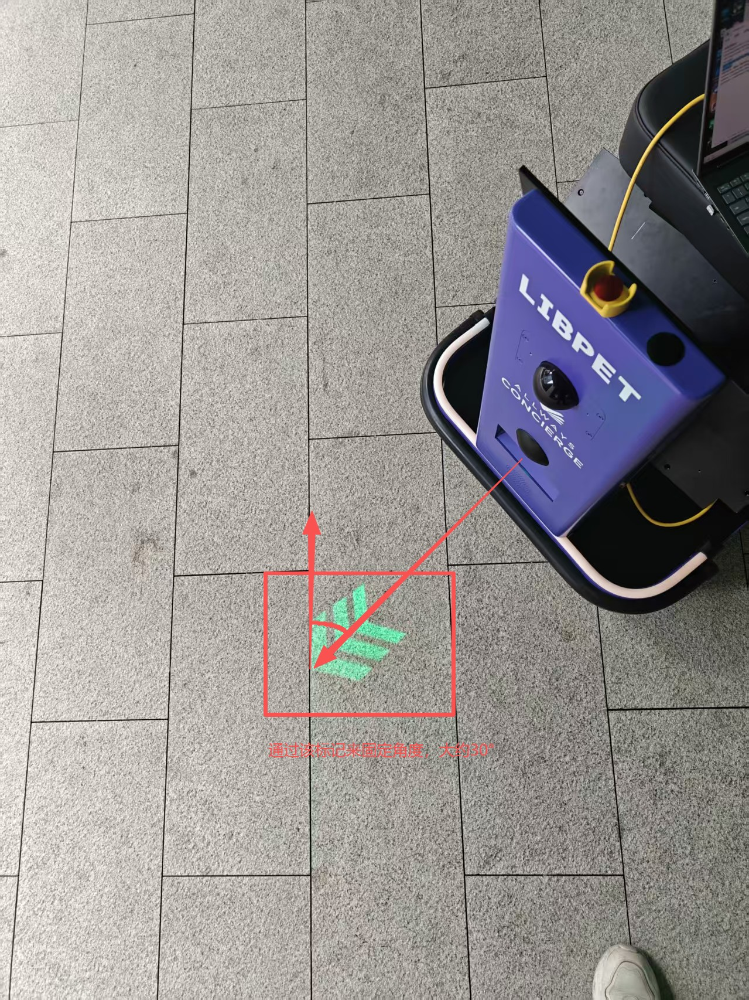
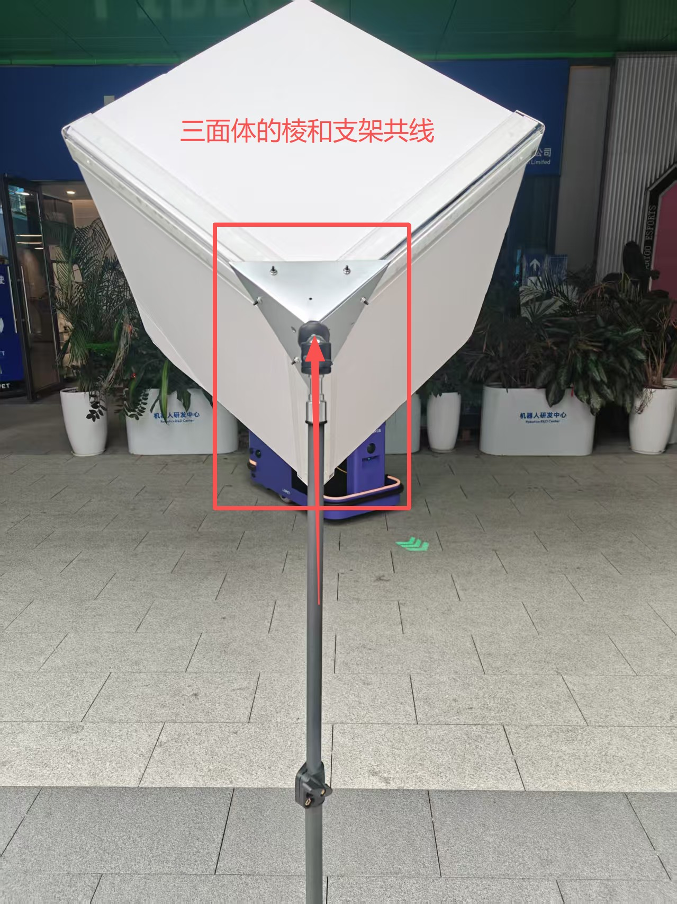
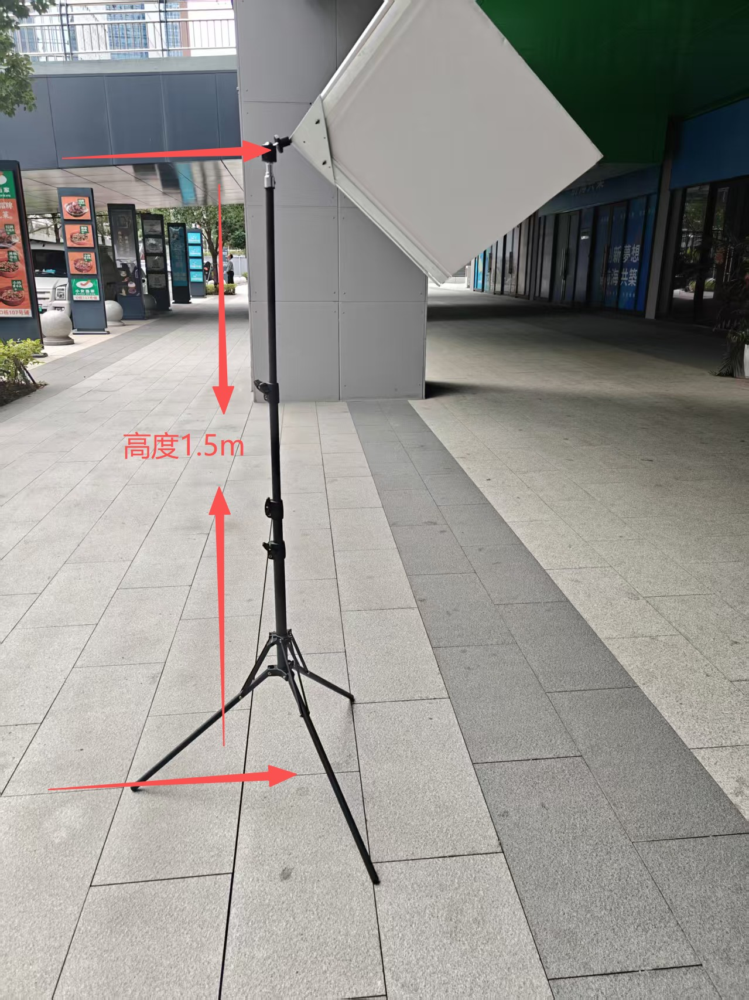
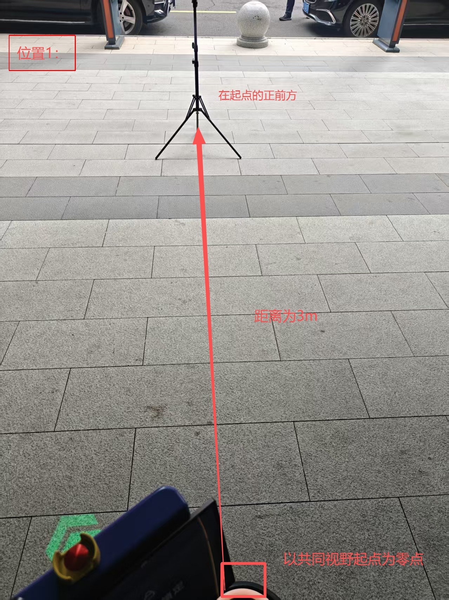
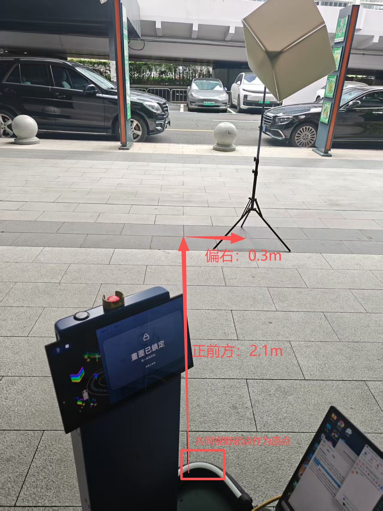
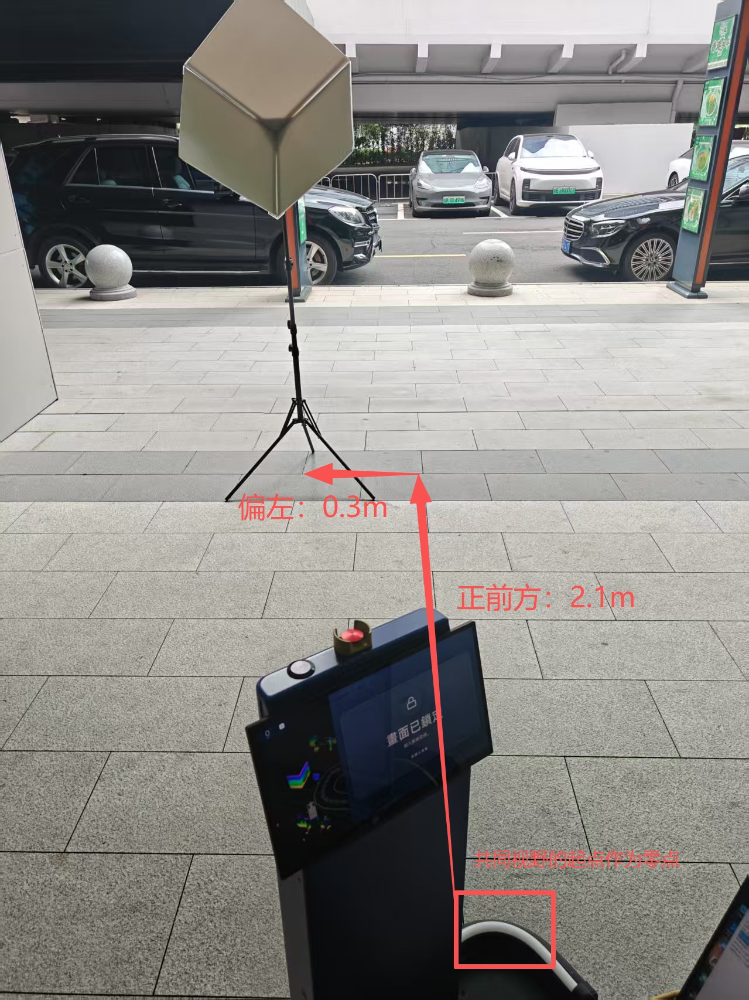

# LiDAR Cube Viewer V02 · APS 四雷达静态标定

一台 APS 采六个静态包，操作员在一个窗口核对六个靶框，点击一次即可求出前、左、右、顶四台雷达相对 `sensor_kit_base_link` 的安装外参。需要同一台车、同一次安装。软件固定前雷达，左、右两组共用同一个顶部雷达解。

## 安装和启动

使用 Ubuntu 22.04、ROS 2 Humble、系统 Python 3 和图形桌面（WSL 可用 WSLg）。已安装 Humble 并配置 ROS 软件源后执行：

```bash
sudo apt update
sudo apt install git python3-numpy python3-scipy python3-yaml python3-tk python3-matplotlib fonts-noto-cjk ros-humble-rclpy ros-humble-sensor-msgs ros-humble-tf2-msgs ros-humble-ros2bag ros-humble-rosbag2-storage-default-plugins
git clone --branch V02 https://github.com/Libpet-Siyuan-Owen/lidar_cube_viewer.git
cd lidar_cube_viewer/V02
source /opt/ros/humble/setup.bash
/usr/bin/python3 lidar_cube_viewer.py
```

已有仓库可执行 `git fetch origin --tags`，运行 `git checkout V02` 后进入 `V02/`。每个新终端先加载 Humble 环境。离线标定无需启动车辆节点。

## 准备场地和六个摆位

选空旷平地，用支架固定约 40 cm 边长的三面体。先摆前、左、顶共同可见的一组，再摆前、右、顶共同可见的一组。每组都从**本组共同视野的起点**沿地面基线量距，面向正前摆位区分左偏、右偏。按图在地面标出 APS 方向，车体与图示参考方向约 30°。调好靶的朝向和倾角，让三面交点朝向本组雷达，并按图对齐棱线与支架。高度按图中标示的支架连接位置量至地面，约 1.5 m。

| APS 方向和地面标记 | 从雷达一侧检查三面体朝向 | 从侧面量靶高 |
|---|---|---|
|  |  |  |

| F · 正前 | R · 右偏 | L · 左偏 |
|---|---|---|
| 向前 3.0 m，横移 0 | 向前 2.1 m，再向右 0.3 m | 向前 2.1 m，再向左 0.3 m |
|  |  |  |

每个摆位先确认本组三台雷达都能看到三个面，再开始录制。录制期间 APS 和支架都保持静止；停止录制后再移动到下一摆位。可点击图片查看原始标注。

## 数据命名与采集

一台 APS 对应一个父目录。每个 bag 直接放在该目录下，保留 `metadata.yaml` 和全部 `.db3` 分片。软件从 **bag 子目录名** 提取关键词。

| 内容 | 识别方式 |
|---|---|
| 雷达组合 | `front`、`left`、`top` 为 FLT；`front`、`right`、`top` 为 FRT。英文雷达名可换序、连写，大小写均可。只写 `FLT` 或 `FRT` 不足以识别组合。 |
| 摆位 | 在雷达名以外取大写 `F`、`L` 或 `R`，分别代表正前、左偏、右偏。字母可在目录名任意位置，可以紧邻数字或小写描述，也支持原有 `F3d`、`0.3L`、`0.3R`。推荐用下划线隔开。连续大写缩写里的字母不算摆位。 |
| 缺少或有歧义 | 缺少关键词、同时出现两种侧雷达或两种方向，均不自动归位。同一格有多个候选时点该格人工选包。已有机器配置会优先恢复已保存的选择。 |

例如 `L_topfrontleft_001` 和 `static_front_top_left_0.3L_2.1d_1.5h` 都属于 FLT 左偏。下面六条采集命令本身就是一套可用的目录命名示例。

在能收到车辆 ROS 2 话题的终端运行以下准备命令。将 `aps_001` 改为本台机器编号。函数每次录制三路点云、`/tf` 和 `/tf_static`，共五个话题。

```bash
source /opt/ros/humble/setup.bash
mkdir -p ~/calibration_ws/data/aps_001
cd ~/calibration_ws/data/aps_001
record_pose() {
  local side="$1" pose="$2"
  ros2 bag record -s sqlite3 -o "front_${side}_top_${pose}" \
    /sensing/lidar/front/pointcloud_raw_ex \
    "/sensing/lidar/${side}/pointcloud_raw_ex" \
    /sensing/lidar/top/pointcloud_raw_ex /tf /tf_static
}
```

**每摆好一个位置，单独运行对应的一行。** 等三路点云均有多帧后按 `Ctrl+C` 结束当前包。

| 摆位 | 前左顶 | 前右顶 |
|---|---|---|
| 正前 | `record_pose left F` | `record_pose right F` |
| 左偏 | `record_pose left L` | `record_pose right L` |
| 右偏 | `record_pose left R` | `record_pose right R` |

用 `ros2 bag info front_left_top_F` 检查该包，确认三路 `sensor_msgs/msg/PointCloud2` 和 `/tf_static` 的消息数大于零，并检查 `/tf`。前点云的 `frame_id` 应为 `rslidar_airy_front`，静态变换链应能连接 `sensor_kit_base_link` 与各雷达。世界坐标预览需要能定位前雷达的 `map` 变换。

## 操作与导出

1. 点击 **选择数据目录**，选含六个 bag 的机器目录。上排为前左顶，下排为前右顶，每排依次为正前、左偏、右偏。发现错包可点击对应格更换。
2. 核对六格 **绿色实线 ROI** 是否完整包住靶的三个面。虚线表示自动搜索范围。点击格子可在 XY、XZ 两个投影拖动绿框，或扩大、缩小，再点 **确认此 ROI**。未能自动定位的格子需要人工确认。无地图时预览可使用前八帧；正式累计读取全包。
3. 需要调整时展开 **平面拟合参数（六包共用）**。默认内点距离 0.02 m，最少 20 个内点，3 个面，100 次迭代，最小面间夹角 80°，跨度范围 0–2 m。首先检查 ROI，确认排除了地面、支架和墙面，再调整这些参数。
4. 点击 **确认全部并开始标定**。程序先用每包的 `/tf_static` 累计、滤波和提取三个面，再固定前雷达，以六个摆位的点面残差联合求解其余三台雷达。最后用同一套候选外参重新读取六个原始包，累计、滤波、提面并评分。下方的「初始」和「复验」分别对应这两次测量。
5. 在 **平面拟合** 或 **面面匹配** 页切换数据表／柱状图。柱状图按摆位查看，灰色表示初始外参，蓝色表示联合外参；悬停可看评级和逐面失败原因。**安装修正** 表给出相对 `/tf_static` 的变化。结果轮次下拉框可回看当前窗口内的运行。
6. 复验通过后点击 **打开最终外参**。机器目录下每次完整复验都会生成新的 `FLRT_V02_result_report_时间戳/`。`suggested_extrinsics.yaml` 是可交付的外参，XYZ 单位为 m，roll/pitch/yaw 为 rad。`validation.json` 包含初始、复验的逐面和逐配对指标以及失败项，`batch_config.yaml` 记录 ROI 和参数。复验未通过时可查看 `candidate.yaml` 辅助排查。提前中止时查看界面状态和已完成的表格行。

机器目录中的 `V02_machine.yaml` 保存六包选择和共用参数，各包的 `V02_ROI.yaml` 保存已确认的范围。完整评级标准与计算例子见[指标与评级](docs/metrics.md)。
